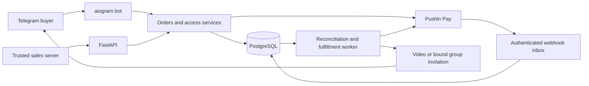

# Architecture

## Components

| Layer | Files | Responsibility |
| --- | --- | --- |
| Configuration | `src/vip/config.py`, `catalog.py` | Secret references, opt-in flags, configurable offer names/prices |
| Telegram presentation | `bot.py`, `bot_ui.py`, `bot_payment_ui.py` | Private commands/callbacks, atomic inline menus, safe payment state |
| Purchase lifecycle | `bot_purchases.py`, `purchase_attempts.py`, `catalog.py`, `orders.py` | Buyer binding, snapshots, attempt reservation and abandoned purchase decisions |
| Provider adapters | `payments/pushinpay.py`, `payments/omega.py`, `payments/operations.py` | Bounded provider requests and reconciliation |
| Settlement | `payments/service.py`, `entitlements.py` | Verified credit, unique transactions and access grants |
| Webhook transport | `pushin_webhooks.py`, `webhooks.py` | Bounded receipt and provider-specific authentication |
| Delivery | `fulfillment.py`, `fulfillment_worker.py`, `video_delivery.py`, `groups.py` | Durable claims, entitlement checks, private delivery and invitations |
| Recovery | `recovery.py`, `recovery_rules.py`, `recovery_worker.py` | Consent and abandoned-purchase eligibility, leases and terminal send states |
| Persistence | `db.py`, `models.py`, `alembic/` | Transactions, constraints and migration history |

## Payment trust boundaries

Order creation snapshots the product name, amount, currency and entitlement targets. A unique sales request and buyer/product purchase attempt prevent repeated callbacks from blindly creating charges. Charge creation reserves durable state before its network request. A timeout remains uncertain and requires reconciliation.

Pushin webhook receipt authenticates an independent header token and stores a notification. A provider status in webhook JSON does not grant access. Reconciliation queries the known transaction with provider credentials, checks its frozen amount/currency and records a verified payment. Unique transaction/order constraints and durable event records prevent replay from granting duplicate access.

The Pushin query gate is account-wide and permits a query no more frequently than once per minute. The bot worker processes persisted notifications and delivery jobs. API-only operation does not run this worker. Interactive status requests share the query budget. Authenticated notifications for other orders take priority over manual refreshes, preserving the provider limit while preventing an unpaid buyer from continuously consuming slots ahead of notified payments. High-volume backlogs still require capacity planning.

## Fulfillment and uncertainty

Fulfillment requires a paid, identity-bound order and active matching grants. The worker obtains durable claims and uses buyer locks. Video file IDs are per bot/content hash, and group invitations bind the requesting identity, chat, creator, expiry and entitlement. A shared link alone does not authorize another user.

A definite transport rejection may be retryable. An ambiguous send cannot safely be replayed automatically: it becomes uncertain or needs operator review. Refund/reversal handling must be evaluated separately; paid-to-canceled/expired Pushin observations are retained for review and do not implement a complete chargeback/refund lifecycle.

## Database and runtime

Hosted roles use PostgreSQL, migration-head checks and a PostgreSQL advisory lock for the single polling bot. SQLite uses foreign keys and serialized development transactions. Direct development entrypoints support SQLite; use `vip.deployment` for hosted operation and ownership guards.

The original functional module boundaries are retained. Private operational documentation, business identifiers, media and state are absent. This is a fresh database lineage for an independent installation; never apply these renamed migrations to an existing commercial database.

## Optional legacy surfaces

The Omega vendor adapter and plan/subscription flows remain because they share existing service/reconciliation code and are separate from the removed browser flow. The Omega payment integration is disabled by default and is not required for Pushin Pay; plan/order APIs remain available behind the sales-server key. Server API credentials authorize a trusted sales server broadly; that caller must authenticate buyer identities.

There is no public browser checkout or web-purchase bridge: `/checkout` and `/web/purchases`, including their child routes, are not registered. Obsolete checkout/login settings cannot restore them. Browser assets, OIDC code and its exclusive dependency were removed. The historical `web_purchases` table and existing migrations remain for schema continuity; no current route creates web-purchase records. No replacement checkout was implemented.
